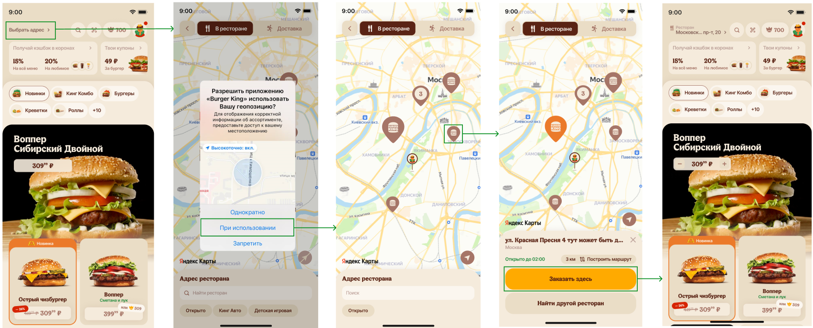
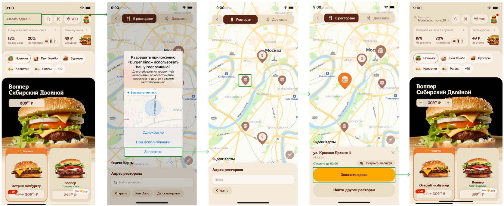
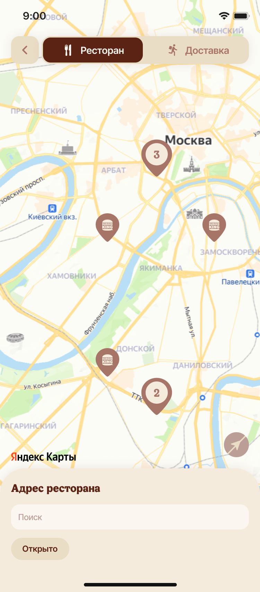

== Пример куска ТЗ на фронт Рестораны

=== UC_1 Выбор ресторана на карте при первом запуске приложения

==== Актеры

* Мобильное приложение (далее - МП) 
* Пользователь  

==== Предусловия

* МП установлено на устройстве пользователя и запущено в первый раз   
* Пользователь находится на главном экране
* Запрос https://confluence.burgerkingrus.ru/pages/viewpage.action?pageId=197234698[GET /api/v7/restaurants] вернул успешный ответ
или link:api/api/OpenApi_Sunset-275050-1ac47b.yaml[GET /api/v7/restaurants]

==== Шаги

Ссылка на фигму: https://www.figma.com/design/KoBEMwYlHas2FuAXjBMlLU/Phoenix-Guzel?node-id=36-1197&t=ggRAiDTRnAApQdD0-4[макет кейса] 

. Пользователь нажимает на блок "Выбрать адрес" на главном экране
. Отображает боттомшит "Адрес ресторана" и системное уведомление о предоставлении доступа к геолокации
. Пользователь нажимает "Однократно" или "При использовании"     
МП отображает пин местоположения пользователя и видоизменяет иконку гео
. Пользователь нажимает на пин ресторана на карте
. МП окрашивает выбранный пин в оранжевый и отображает боттомшит "Карточка ресторана"
Пользователь нажимает на "Заказать здесь"
. МП закрывает экран "Рестораны" и отображает на главном экране в навбаре адрес выбранного ресторана

==== Результат

Пользователь предоставил доступ к гео и выбрал ресторан на карте

=== AC_1.1 Выбор ресторана на карте при первом запуске приложения без доступа к гео

==== Шаги

Ссылка на фигму: https://www.figma.com/design/KoBEMwYlHas2FuAXjBMlLU/Phoenix-Guzel?node-id=36-12961&t=ggRAiDTRnAApQdD0-4[макет кейса] 

Примечание: #Экран Главной страницы временный, финальный дизайн отсутствует
На 2ом макете неверно отрисована поисковая строка и фильтры
Верный текст в свитчере - "Ресторан"#

. Выполнить шаги 1-2 основного сценария
. Пользователь нажимает "Запретить"
. МП закрывает попап
. МП не видоизменяет иконку гео после выбора пользователя
. Выполнить шаги 5-8 основного сценария 

==== Результат

Пользователь не предоставил доступ к гео и выбрал ресторан на карте

=== AC_1.1 Выбор ресторана на карте при первом запуске приложения без доступа к гео

==== Шаги

. Выполнить шаги 1-2 основного сценария
. Пользователь нажимает "Запретить"
. МП закрывает попап
. Пользователь тапает на иконку гео
. МП отображает кастомное окно с доступом к гео
.. Пользователь тапает "Не сейчас"(переходим к п.6)
.. Пользователь тапает на "Настройки", включает гео(далее шаги с 4 uc_1) 
. МП не видоизменяет иконку гео после выбора пользователя
. Выполнить шаги 5-8 основного сценария 

==== Результат

Пользователь не предоставил доступ к гео и выбрал ресторан на карте

==== Неудачный пример применения таблицы в юз кейсах

|===
|Актеры |
* Мобильное приложение (далее - МП) 
* Пользователь 

|1	| Доступ к гео предоставлен: 

| Боттомшит Адрес ресторана
Отображается при входе на экран карты в режиме "В ресторане" при невыбранном ресторане:
|2	| Нулевой стейт:| Боттомшит Адрес ресторана. Активный поиск
Поле ввода имеет текст-заглушку: "Поиск".   
Ссылка на гайдлайны
|===

== Ссылка на АПИ

link:api/api/OpenApi_Sunset-275050-1ac47b.yaml[Get_sunrise.yaml]

[cols="1;3;6, options="header"]  

|===
|№ |Слепок дизайна экрана | Описание
|1	| Доступ к гео предоставлен: 

| Боттомшит Адрес ресторана
Отображается при входе на экран карты в режиме "В ресторане" при невыбранном ресторане:
|2	| Нулевой стейт:| Боттомшит Адрес ресторана. Активный поиск
Поле ввода имеет текст-заглушку: "Поиск".   
Ссылка на гайдлайны

Тап по строке поиска активирует курсор и буквенно-цифровую клавиатуру с русской раскладкой по умолчанию. В списке отображаются все рестораны, берем из кэша запроса GET /api/v7/restaurants. Сортировка:

если доступ к гео предоставлен, и получены текущие координаты пользователя: по удаленности от пользователя (от ближайшего ресторана к дальнему)
если доступ к гео не предоставлен, или предоставлен, но текущие координаты пользователя не получены: по алфавиту (по параметру "result.restaurants.name"), удаленность ресторана от пользователя не отображается
Аналогичная сортировка применяется для результатов поисковой выдачи.

Количество символов для ввода не ограничено. Для ввода и вставки в поле поиска доступны следующие символы:

кириллица и латинские буквы;
цифры;
пробел и специальные символы (доступны по переключению с английской раскладки)
Поиск вариантов начинает при вводе 2х символов. При вводе текста (2 и более символов) в поле поиска поисковая выдача меняется динамически, показывая только те рестораны, которые соответствуют запросу.

Поиск выполняется на клиентской стороне по параметрам "result.restaurants.name" И "result.restaurants.city.city_name". Если у ресторана оба параметра подходят под запрос, то такой ресторан отображается один раз.

У каждого ресторана отображается:

адрес ресторана  "result.restaurants.name"
Если текст адреса ресторана слишком длинный, то он ограничивается двумя строками и далее сокращается справа троеточием.
город ресторана "result.restaurants.city.city_name"
статус "Нельзя заказать, но можно посмотреть меню" (только у ресторанов без МП, см. экран 6)
статус работы ("Открыто до ..."/"Закрыто до ...")
удаленность от пользователя (если пользователь предоставил доступ к гео, и получены его текущие координаты). Если расстояние от ресторана до пользователя менее 1 км, то оно отображается в формате "850 м" (целое число), если более 1 км, то в формате "1,1 км" (1 цифра после запятой). Значения округляются в большую сторону.
Результаты поиска можно скроллить вертикально. Во время просмотров результатов клавиатура остается всегда открытой, строка поиска и заголовок запинены.

Как в нулевом стейте, так и во время поиска можно выбрать фильтр "Открыто": в поисковой выдаче скроются те рестораны, которые закрыты на текущий момент. Логика работы фильтра описана выше (см. экран 1)

Действия по нажатию:

Тап на ресторан в результатах поиска открывает карточку ресторана, скроллим пользователя до местоположения пина ресторана.
Тап на крестик в поле ввода очищает строку поиска, возвращая в состояние с активным курсором и открытой клавиатурой.
Тап на иконку "крестик"/ свайп очищает поиск и сворачивает боттомшит "Адрес ресторана" в состояние неактивного поиска. На экране отображается боттомшит, с которого был осуществлен переход на экран активного поиска: карточка ресторана (если переход был по тапу на "Найти другой ресторан") или боттомшит "Адрес ресторана" (если переход был по тапу на строку поиска).
Иконка "крестик" имеет пресстейт с изменением цвета. Ссылка на гайдлайны
|===